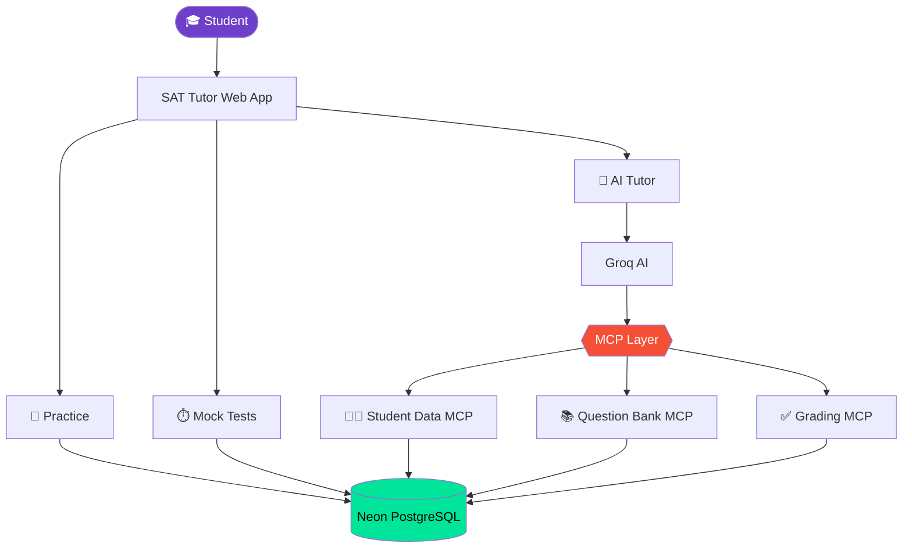

<div align="center">

# 🎓 SAT TUTOR

### The AI-powered SAT prep platform that actually *knows* its student.

Practice · Timed Tests · Adaptive Learning · An AI Tutor wired into your data through **MCP**

<br/>

[](https://sat-tutor-yio8.onrender.com/)

<br/>


<br/>

| 📚 **1,270** questions | 🔌 **3** MCP servers | 🧠 **Elo-style** mastery | 🔐 **Server-side** auth |
|:---:|:---:|:---:|:---:|

</div>

---

## 📖 Table of Contents

- [Why SAT Tutor?](#-why-sat-tutor)
- [Feature Overview](#-feature-overview)
- [The AI Tutor](#-the-ai-tutor)
- [MCP Architecture](#-mcp-architecture)
- [Question Bank](#-question-bank)
- [Learning Engine](#-learning-engine)
- [Admin Dashboard](#%EF%B8%8F-admin-dashboard)
- [Security](#-security)
- [Tech Stack](#%EF%B8%8F-tech-stack)
- [System Architecture](#%EF%B8%8F-system-architecture)
- [Getting Started](#-getting-started)

---

## ⚡ Why SAT Tutor?

Most SAT prep tools do one thing: serve you questions. **SAT Tutor** is a complete preparation loop in a single platform:

```
   Practice  ──▶  Get graded  ──▶  Review mistakes  ──▶  Track mastery
       ▲                                                       │
       └────────  Adaptive engine picks what's next  ◀─────────┘
                                 │
                    AI Tutor explains anything, any time
```

Everything a student does feeds back into what they see next, and the AI tutor can see that context too.

---

## 🧩 Feature Overview

| | Feature | What it gives students |
|---|---|---|
| 🤖 | **AI Tutor** | Concept explanations, help on the current question, resumable chat sessions |
| 📝 | **Practice Mode** | Filter by section, domain, skill and difficulty with instant grading |
| ⏱️ | **Timed Practice Tests** | Real time pressure, submission, results and performance review |
| 🎯 | **Diagnostic Test** | A baseline of strengths and weaknesses to start from |
| 🧠 | **Adaptive Learning** | Per-skill mastery, spaced repetition, smart next-question selection |
| 📊 | **Progress Dashboard** | Accuracy, mastery, difficulty performance, recent activity |
| ❌ | **Mistake Review** | Revisit missed questions with full explanations |
| 🔖 | **Bookmarks** | Personal saved questions, scoped per student |
| 📅 | **Daily Challenge** | A shared daily question that feeds streaks and achievements |
| 🏆 | **Streaks & Achievements** | Consistency rewards that keep students coming back |
| 📋 | **Study Planning** | Deterministic plans built from real activity and performance |
| 🛠️ | **Admin Dashboard** | Users, questions, feedback and analytics in one place |

---

## 🤖 The AI Tutor

Powered by **Groq**, and connected to the app through **Model Context Protocol (MCP)**.

Students can:

- 💬 Ask about any SAT concept and get a clear explanation
- 🔍 Discuss the exact question they're solving right now
- ♻️ Continue and resume previous conversations
- 🎯 Get tutoring shaped by their own learning context

---

## 🔌 MCP Architecture

The tutor doesn't get raw access to everything. Its abilities are split across **three dedicated MCP servers**, each with a single responsibility:

| Server | Responsibility | Exposes |
|---|---|---|
| 🧑‍🎓 **Student Data MCP** | Who the student is and how they're doing | Profiles, attempt history, learning progress, performance |
| 📚 **Question Bank MCP** | What can be asked | Questions, metadata, sections, domains, skills, difficulty |
| ✅ **Grading MCP** | Whether an answer is right | Answer evaluation, correct/incorrect results, scoring |

This separation keeps responsibilities clean and lets the AI interact with the application only through dedicated, purpose-built tools.

---

## 📚 Question Bank

A structured bank of **1,270 imported questions** (production) spanning **Math** and **Reading & Writing**, each carrying:

`Domain` · `Skill` · `Difficulty` · `Metadata` · `Correct answer` · `Explanation`

**Built-in quality validation** catches:

- ❗ Duplicate question stems
- ❗ Invalid answers
- ❗ Inconsistent choices
- ❗ Missing metadata

---

## 🧠 Learning Engine

The goal: go beyond random questions and let past performance guide future practice.

| Component | Purpose |
|---|---|
| **Per-skill mastery** | Know exactly which skills are strong or weak |
| **Elo-style tracking** | Mastery rises and falls with each attempt |
| **Spaced repetition** | Resurface material at the right time |
| **Adaptive selection** | Choose the next question from performance history |
| **Attempt history** | Every answer stored for later analysis |

### After every practice answer, students get

✅ Immediate grading · 💡 Explanation · ⏱️ Time info · 🔔 Hints · 📈 Mastery update

> **Note on scoring:** practice-test results are a score **estimate**. SAT Tutor does not claim to reproduce an official College Board score conversion.

---

## 🛠️ Admin Dashboard

<details>
<summary><b>👥 User Management</b></summary>

- Search students
- View student information
- Suspend users and manage status

</details>

<details>
<summary><b>❓ Question Management</b></summary>

- View, create and edit questions
- Manage question metadata
- Approve questions
- Manage the whole question bank

</details>

<details>
<summary><b>💬 Feedback Management</b></summary>

- View student feedback and bug reports
- Review reports
- Update status and triage issues

</details>

<details>
<summary><b>📈 Analytics</b></summary>

- Skill accuracy
- Difficulty performance
- Most-missed questions
- Student activity

</details>

---

## 🔐 Security

| Layer | Protection |
|---|---|
| **Authentication** | Registration, login, password hashing, session-based auth, HttpOnly + SameSite cookies |
| **Authorization** | Student identity is resolved from the **server-side session**, so the browser can't simply send another student's ID. Admin APIs require an authenticated administrator |
| **Data protection** | Student-scoped data, environment-variable secrets, database transactions, rate limiting, secure session tokens |

> 🚫 API keys, database credentials and passwords must **never** be committed to the repository.

---

## 🏗️ Tech Stack

<table>
<tr>
<td width="25%" valign="top">

**🎨 Frontend**
- TypeScript
- Practice interface
- Timed testing UI
- Progress dashboard
- AI Tutor interface
- Admin dashboard

</td>
<td width="25%" valign="top">

**⚙️ Backend**
- Node.js
- TypeScript
- HTTP APIs
- Session-based auth

</td>
<td width="25%" valign="top">

**🗄️ Data & AI**
- PostgreSQL
- Neon (production)
- Groq API
- Model Context Protocol

</td>
<td width="25%" valign="top">

**☁️ Deployment**
- Render (web app)
- Neon (database)

</td>
</tr>
</table>

<details>
<summary><b>What the database stores</b></summary>

Users · Student profiles · Questions · Attempts · Scores/results · Mastery data · Bookmarks · Chat sessions · Chat messages · Feedback · Daily challenges · Achievements · Audit information

</details>

---

## 🏛️ System Architecture



---

## 🚀 Getting Started

> ⚠️ Adjust script names and variables below to match your project.

```bash
# 1. Clone
git clone <your-repo-url>
cd sat-tutor

# 2. Install
npm install

# 3. Configure environment
cp .env.example .env
#   DATABASE_URL=...   (PostgreSQL / Neon connection string)
#   GROQ_API_KEY=...
#   SESSION_SECRET=...

# 4. Run
npm run dev
```

---

<div align="center">

### 🌐 [**Launch SAT Tutor →**](https://sat-tutor-yio8.onrender.com/)

Built with **Groq · MCP · PostgreSQL · TypeScript**

*Practice smarter. Learn faster. Score higher.*

</div>
